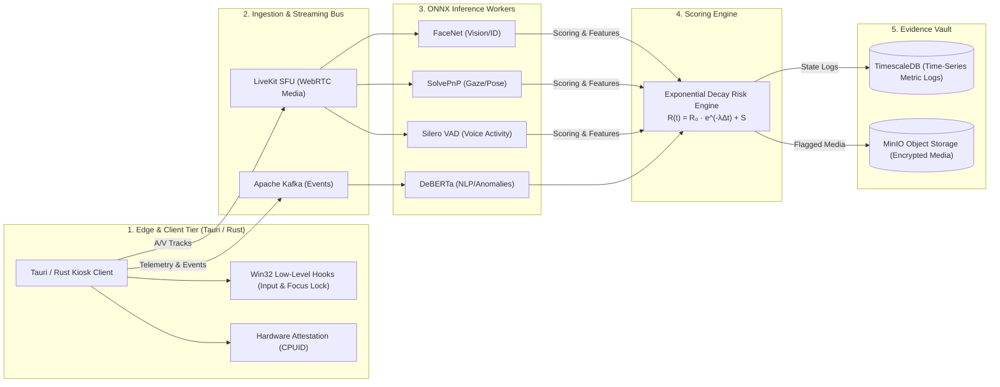

# System Architecture

The following diagram illustrates the end-to-end data pipeline from the edge kiosk client through stream ingestion, neural inference workers, continuous risk scoring, and evidence storage.

